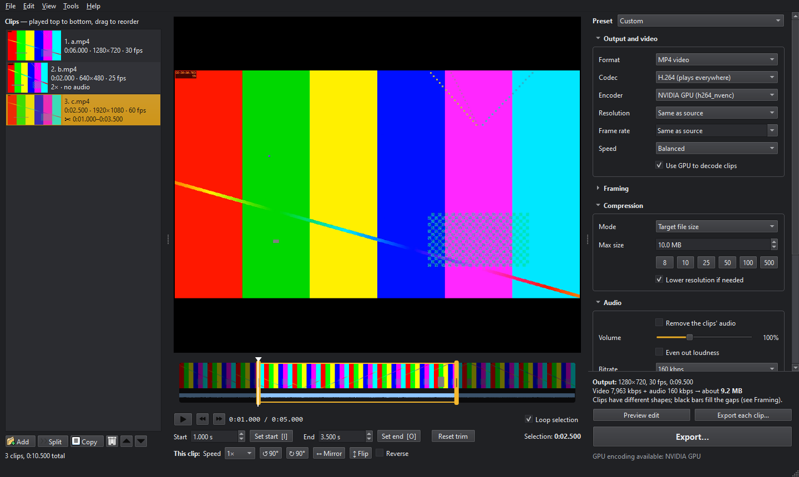

# QuickCut

A desktop app for everyday video jobs:

- trim clips and join them together
- change the frame rate, resolution or shape (vertical for Shorts/Reels/TikTok)
- add music, text and transitions
- compress the result: by quality, to a size limit such as 10 MB for Discord, or with manual settings

It uses FFmpeg underneath and can encode on your GPU (NVIDIA, AMD or Intel).



## Download

Get the latest **QuickCut-x.y.z-windows-x64.zip** from [Releases](https://github.com/nparbs/QuickCut/releases), extract it anywhere and run **QuickCut.exe**. FFmpeg is included and no install is needed.

To open videos straight from Explorer, turn on **Tools → Add “Open with QuickCut” to Explorer**. On Windows 11 the entry is under *Show more options*.

## Features

**Editing**
- **Trim** each clip by dragging the yellow handles on the timeline (with filmstrip and waveform), typing times, or pressing **I** / **O** at the playhead.
- **Split** at the playhead (S), **duplicate** (Ctrl+D), and drag clips to reorder them.
- Per clip: **speed** 0.25×–4× (audio keeps its pitch), **rotate**, **mirror/flip**, **reverse**.
- **Framing**: 16:9, 9:16, 1:1, 4:5, 4:3 or 21:9, filled with black bars, cropped, or over a blurred copy of the video.
- **21 transitions** between clips (crossfade, dip to black, wipes, slides…), plus **fade in / out**.
- **Background music** with its own volume, looping and a fade at the end.
- **Text and logo** overlays with position, size, colour and timing.
- **Undo / redo**, and **projects** (`.qcut`) you can save and reopen.

**Export**
- **Presets** for Discord, WhatsApp, email, YouTube, Shorts/Reels/TikTok, Instagram, X, GIF and MP3.
- **Compression**:
  - *Quality preset:* High / Balanced / Small / Smallest.
  - *Target file size:* type a maximum such as 10 MB. CPU encoders use two-pass. If a file still comes out too big, it's re-encoded at a lower bitrate automatically. If the limit is too small for the resolution, the resolution is lowered instead of turning blocky.
  - *Manual:* constant quality (CRF/CQ) or a fixed bitrate.
  - *No re-encode:* instant, lossless cuts and joins (cuts snap to keyframes).
- **Formats**: MP4, MKV, MOV, WebM, GIF, animated WebP, MP3, M4A, WAV.
- **Codecs**: H.264, HEVC, AV1 and VP9, on the CPU or GPU. QuickCut checks at startup which ones your PC can use.
- **Audio**: remove, volume 0–300 %, even out loudness, bitrate.
- **HDR** phone videos are converted to normal colours, so they don't look washed out.
- **Export queue**: keep editing while exports run one after another. You can also **export each clip separately**.
- **Preview edit** (Ctrl+P): a quick low-resolution render of the whole edit, with transitions, text and music.

## How to use

1. **Add videos:** click **Add**, press Ctrl+O, or drop files or folders onto the window.
2. **Trim and edit:** select a clip, set its start and end, and adjust speed, rotation and so on under the player.
3. **Order:** drag clips in the list. They're joined top to bottom.
4. **Choose settings** on the right, or pick a **Preset**. The summary underneath shows the output size, length and estimated file size.
5. **Export…** and pick where to save. Use **Preview edit** first to check the result.

### Keyboard shortcuts

| Key | Action |
| --- | --- |
| Space | Play / pause |
| I / O | Set start / end at the playhead |
| ← / → | Step one frame (Shift: one second) |
| Home / End | Jump to the trim start / end |
| S | Split the clip at the playhead |
| Ctrl+D | Duplicate the clip |
| Delete | Remove the selected clip |
| Ctrl+Z / Ctrl+Y | Undo / redo |
| Ctrl+S | Save project |
| Ctrl+P | Preview the full edit |
| Ctrl+E | Export |
| Ctrl+J | Show the export queue |

## Notes

- The output's shape and (when set to *Same as source*) frame rate come from the **first** clip, unless you pick a shape under **Framing**.
- "1080p" means the short side, so 9:16 at 1080p is 1080×1920.
- Transitions are limited to half the length of the shortest clip.
- GPU encoders are much faster; CPU encoders compress a little better and hit size targets more precisely.
- The player shows trims, speed, rotation and flips. Use **Preview edit** to see reverse, framing, transitions, text and music.

## Run from source

Requires Python 3.10+ and FFmpeg (`winget install Gyan.FFmpeg`).

```
git clone https://github.com/nparbs/QuickCut.git
cd QuickCut
pip install -r requirements.txt
python -m quickcut
```

Double-click `run.pyw` to start without a console window. QuickCut looks for FFmpeg in `QUICKCUT_FFMPEG_DIR`, then an `ffmpeg` folder next to the app, then your `PATH`.

## Development

```
pip install -r requirements-dev.txt
python -m pytest
```

The tests generate synthetic clips and run real exports through FFmpeg. They cover every editing and export feature, every encoder available on the machine (others are skipped), and the main window itself. The GUI tests run off-screen.

To build the standalone app:

```
python packaging/build.py --ffmpeg-dir "C:\path\to\ffmpeg\bin"
```

This writes `dist/QuickCut/` and a zip, after checking that the packaged app starts and finds its bundled FFmpeg. Pushing a `v*` tag makes GitHub Actions run the tests, build the zip and publish a release with the matching [CHANGELOG](CHANGELOG.md) notes.

| File | Purpose |
| --- | --- |
| `quickcut/command.py` | Builds the FFmpeg filter graph and command lines (pure functions) |
| `quickcut/ffmpeg.py` | Finds FFmpeg, probes files, detects usable encoders |
| `quickcut/exporter.py` | Runs export passes with progress, time left, cancel and retries |
| `quickcut/jobs.py` | Export queue and its panel |
| `quickcut/main_window.py` | Clip list, player, editing, projects, undo, menus |
| `quickcut/export_panel.py` | Export settings panel and presets |
| `quickcut/media_cache.py` | Thumbnails, filmstrips and waveforms in the background |
| `quickcut/overlays.py` | Renders text and logos to PNG overlays |
| `packaging/` | Standalone build, icon and release notes |

## Roadmap

See [ROADMAP.md](ROADMAP.md) for what's done, known limitations and future ideas.

## License

MIT for QuickCut. The standalone download bundles FFmpeg (GPL), Qt (LGPL) and Python. See [THIRD_PARTY.md](THIRD_PARTY.md).
